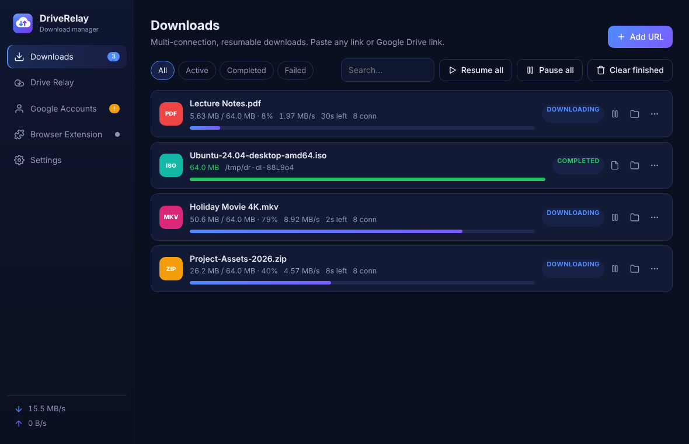
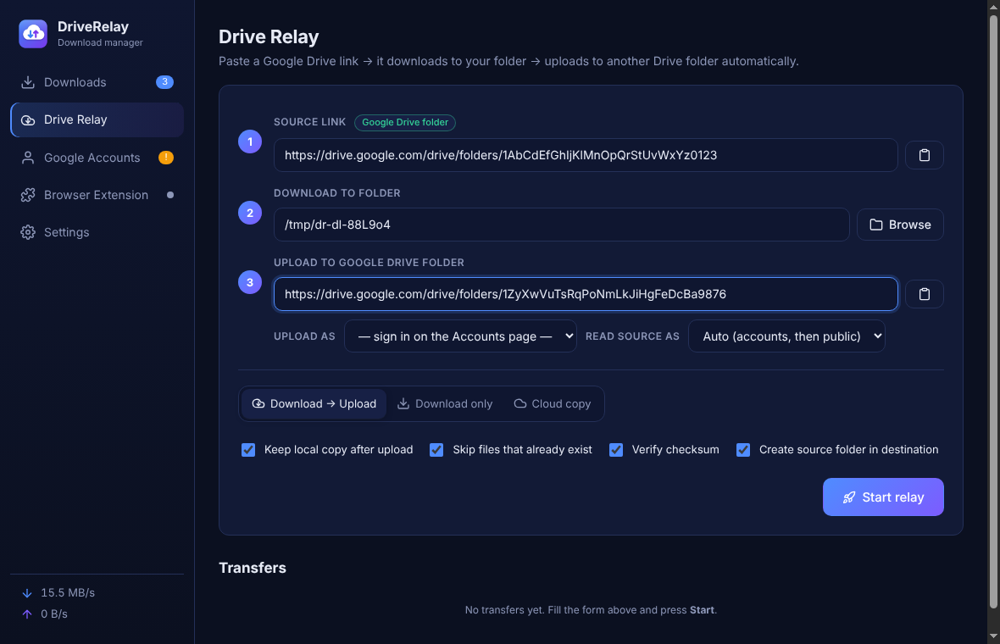

# DriveRelay — Download Manager + Google Drive Relay

DriveRelay is a desktop download manager for **Windows** and **macOS** with one extra trick:
paste a Google Drive link, pick a local folder and a destination Drive folder, and it will
**download the file(s) automatically and then upload them to the other Drive folder** — no
babysitting.



## Features

### Download manager (IDM-style)
* **Multi-connection segmented downloads** (1–32 connections per file) with **dynamic
  segmentation**: when a connection finishes, it takes over half of the slowest remaining part.
* **Pause / resume**, even after closing the app or rebooting (state is saved continuously).
* Automatic **retries** with back-off, stall detection, global **speed limit**, download **queue**
  with a configurable number of simultaneous downloads.
* Understands **Google Drive** links (files, folders, Docs/Sheets/Slides → exported to Office),
  **Dropbox**, **OneDrive** and **GitHub** share links.
* Drag & drop links onto the window, clipboard detection, notifications, tray / menu-bar icon.

### Drive Relay (the main idea)
1. **Source** – a Google Drive file *or folder* link (or any direct download link).
2. **Download to** – a folder on your computer.
3. **Upload to** – a Google Drive folder link.

Press **Start** and DriveRelay:
* reads the source (whole folders recursively, keeping the sub-folder structure),
* downloads each file with the multi-connection engine (and verifies the MD5 checksum),
* **uploads each file as soon as it finishes** (resumable 16 MB chunks, survives network drops),
* recreates the same folder structure in the destination,
* optionally deletes the local copy afterwards.

Modes: **Download → Upload**, **Download only**, or **Cloud copy** (Drive-to-Drive copy on Google's
servers — nothing is downloaded, fastest for big folders). Multiple Google accounts are supported,
e.g. read from account A and upload as account B.



### Browser extension (Chrome, Edge, Brave, Opera, Firefox)
* Takes over browser downloads automatically (with size / file-type filters) and falls back to the
  browser if the app is not running.
* Right-click → **Download with DriveRelay**, **Download all file links on this page**,
  **Send link to Drive Relay**, **Relay this Google Drive page**.
* Forwards cookies + referrer so downloads behind a login keep working.

## Install

Download from the **Releases** page (or the latest *Actions → Build installers* run → Artifacts):

| Platform | File |
| --- | --- |
| Windows 10/11 (installer) | `DriveRelay-Setup-<version>-win-x64.exe` |
| Windows (no install) | `DriveRelay-Portable-<version>-win-x64.exe` |
| Mac with Apple Silicon (M1/M2/M3/M4) | `DriveRelay-<version>-mac-arm64.dmg` or `…-mac-AppleSilicon-arm64.zip` |
| Mac with Intel CPU | `DriveRelay-<version>-mac-x64.dmg` or `…-mac-Intel-x64.zip` |

> Not sure which Mac you have?  → Apple menu → **About This Mac**: "Chip: Apple M…" = Apple Silicon,
> "Processor: Intel" = Intel.

**Windows:** SmartScreen may say "Windows protected your PC" because the app is not code-signed
with a paid certificate → click **More info → Run anyway**.

**macOS:** the app is ad-hoc signed (not notarized by Apple), so the first launch is blocked:
1. Drag **DriveRelay.app** into **Applications**.
2. Open **Terminal** and run: `xattr -cr /Applications/DriveRelay.app`
3. Open the app normally. (Alternative: right-click the app → **Open** → **Open**, or
   System Settings → Privacy & Security → **Open Anyway**.)

### Install the browser extension
The extension ships inside the app: open **Browser Extension → Show extension folder**.
* **Chrome / Edge / Brave / Opera:** `chrome://extensions` → enable **Developer mode** →
  **Load unpacked** → select the `chromium` folder.
* **Firefox:** `about:debugging#/runtime/this-firefox` → **Load Temporary Add-on** →
  select `firefox/manifest.json`.

### Connect Google Drive (needed for uploading)
Follow **[docs/GOOGLE_SETUP.md](docs/GOOGLE_SETUP.md)** — a free, one-time, ~3-minute setup that
creates your own Google OAuth client. Then **Google Accounts → Add Google account**.
Public "anyone with the link" files can be *downloaded* without signing in.

## How it works

```
Browser extension ──HTTP (127.0.0.1:6801)──►  DriveRelay (Electron main process)
                                               ├─ Download engine  (segmented HTTP Range, resume)
                                               ├─ Drive client      (API v3: list, export, copy,
                                               │                     resumable upload)
                                               ├─ Relay jobs        (resolve → download → verify → upload)
                                               └─ OAuth (loopback + PKCE, tokens in OS keychain)
```

* `src/main/downloader/engine.js` – segmented resumable download engine.
* `src/main/google/drive.js` – Drive link parsing, API client, resumable uploads, public links.
* `src/main/transfer.js` – Drive Relay jobs (pipelined download → upload).
* `src/main/server.js` – local bridge for the extension (only answers browser-extension origins).
* `src/renderer/` – the UI. `extension/` – browser extension source.

## Build from source

Requirements: Node.js 20+.

```bash
npm install
npm start            # run the app
npm test             # engine + Drive relay tests (uses a mock Drive server)
npm run dist:win     # Windows installer + portable exe   (on Windows, or Linux with wine)
npm run dist:mac     # macOS dmg + zip, arm64 and x64     (on macOS)
```

Every push runs **.github/workflows/build.yml**, which builds the Windows and macOS packages on
GitHub's runners and attaches them as artifacts. Pushing a tag like `v1.0.0` publishes a GitHub
Release with all files.

## Privacy & security
* Everything runs locally. Files go directly between your computer and Google / the source server.
* Google refresh tokens are encrypted with the OS keychain (DPAPI on Windows, Keychain on macOS).
* The local bridge listens on `127.0.0.1` only and refuses requests from web pages.

## License
MIT
